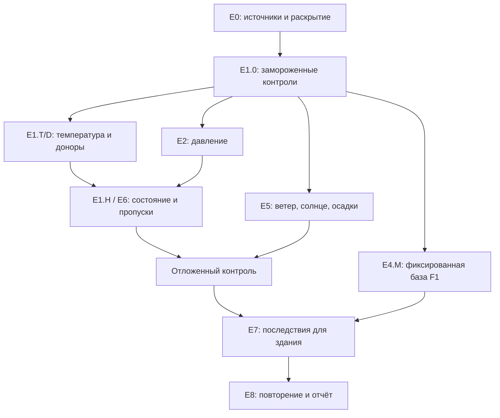

# IGE — единая программа экспериментов E0–E8

**Версия:** 1.0, 7 ноября 2026 года. **Область:** AT / DE / CH.

**Статус:** программа исследований и спецификация документации. Новые расчёты этой
программы не запускались. Принципы зафиксированы; конкретные новые станции, часы,
сравнения, ресурсные лимиты и статистические пороги должны пройти аудит входов и
запечатывание до открытия ошибок. Это ещё не завершённая пререгистрация всех опытов.

Машинный реестр: `research/ige_experiments/program_v1.json`. Шаблон записи прогона:
`run_manifest.template.json`. Источники и прежние результаты: `source_register.json`.
Решения и отличие от прежних протоколов: `DECISIONS_RU.md`.

## 1. Главная организация работы

Работа идёт **последовательными волнами с параллельными независимыми расчётами
внутри волны**. Научный выбор между волнами делается после проверки результатов.
Внутри волны страны, контрольные станции, периоды и варианты с одинаковыми
замороженными входами могут рассчитываться независимо.

Не объединяем три разные задачи в одну оценку:

| Задача | Доступные входы | Проверяемая истина | Основной вывод |
|---|---|---|---|
| Пространственная интерполяция | Синхронные наблюдения соседей, геометрия; фон — отдельная ветвь | Исключённое из входов измерение контрольной станции | Ошибка по доступным часам и покрытие |
| Суточно-почасовая реконструкция | Суточные ограничения и разрешённый prior; давление с явным источником | Известный forward oracle либо независимые наблюдения при сопоставимых операторах | Физическая совместимость, точность и цена изменения исходных ограничений |
| Будущий климат | Локальный климатический эталон, модель/реализация/SSP и периоды | Будущая часовая погода неизвестна | Сохранение сценарных сигналов, распределений, связей и неопределённости |

Успех численного решателя, малая ошибка на синтетике, станционная точность и
работающий экспорт являются разными результатами. Один из них не заменяет другой.

## 2. Что уже является основанием, а что остаётся вопросом

Источники и даты в таблице относятся к ранее выполненным исследованиям, а не к
новой массовой выборке 2016–2025.

| Основание | Установлено | Как используем дальше |
|---|---|---|
| P8.2F | Принятая исследовательская пространственная база; в прежней выборке 78 912 часов MAE T 1,093 K, e 0,554 hPa, RH 6,636 п.п. | Замороженный контроль с исходной областью применимости |
| S1 adapter | Уравнения P8.2F связаны с новым почасовым/месячным интерфейсом; продемонстрирован реальный станционный год Graz 2021 | Отдельный контроль системы; прежние MAE P8.2F не переносятся на адаптер автоматически |
| R1 | Улучшение в AT не обеспечило переносимость в DE/CH | Исследовательский конкурент и отрицательный контроль, без назначения общим default |
| B4 и P1/P2 | B4 ухудшила давление в раскрытом Berlin 2023; пилот P1/P2 не выявил универсального преимущества P2 | Сохраняем отрицательные результаты; проверяем reference и геометрию, не меняем знак ради MAE |
| Ветер P8.3 | Есть зарегистрированные сравнения выбора доноров, scalar/vector/circular и остаточного фона | Повторное использование замороженных вариантов; новые коэффициенты не подбираются на прежнем тесте |
| C2, CD2/CD3 | Улучшены сходимость, масштабирование и проверка производных; меньшая целевая функция не доказала более точную погоду | Численные регрессии перед новым scoring; прежний перебор решателей не повторяем без причины |
| IV1 | Регистрация существует; source lineage отказ не позволил получить новые 84 prior / 420 method records и станционный scoring | Отдельный незавершённый опыт; не объявляем независимую точность подтверждённой |
| F1 | Реализован морфинг выбранной базы с явными климатическими входами; есть исследовательские годовые продукты | Фиксируем версию и проверяем статистику, совместность и ограничение давления |
| Восстановление до 2 ч | Ограниченный рабочий режим существует; прежний аудит преимущественно раскрытый и локальный | Отдельная новая проверка точности и доли допуска; длинные пропуски остаются исследованием |
| Загрузчики AT/DE/CH | Проверены получение, сохранение, единицы/метаданные и повторение малых загрузок | Это готовность инфраструктуры, а не готовая станционная квалификация всех методов |

По сообщению пользователя массовые данные поступают. Полная AT-передача подтверждена
логом 1310/1310 и повторной проверкой без новых запросов. Полные локальные файлы
пользователя в этой среде не проверены; состояние DE/CH не заменяется предположением
о завершении. E0 принимает конкретные готовые снимки/части по их манифестам и не
обязан ждать окончания скачивания всех трёх стран.

## 3. Единица опыта и правила допустимой выборки

### 3.1. Проверяем час и величину

Основная единица пространственного опыта — **площадка × час/интервал × величина**.
Отдельные доступные часы неполного года используются. Наличие полного EPW,
полного T/RH/p-года или всех остальных погодных полей не является входным gate
почасовой исследовательской выборки.

Для ошибки требуется доступный контроль и достаточные для конкретного метода
доноры. Без контроля можно получить прогноз, но нельзя оценить его ошибку.
Для каждой величины рассматриваются только необходимые физические входы.
Недоступное давление не исключает проверку температурного метода, которому p
не требуется. Оригиналы, маски пропусков и QC остаются неизменными.

Через существующий годовой H1-gate эту выборку пропускать нельзя. Требуется
отдельный исследовательский адаптер. Годовой S1 остаётся самостоятельным
замороженным контролем, доступным там, где выполняется его старый контракт.
Изменение правил месячной нормировки, вычисления средних по неполным месяцам
или отбора часов получает отдельный `method_id` и проверку влияния изменения.

### 3.2. QC и происхождение

Автоматически и вручную проверенные непустые наблюдения входят в основную выборку.
Отсутствие ручной проверки не равно неверности, не задаёт произвольного штрафного
веса и не исключает весь год. Для GeoSphere отдельно учитываются вид проверки
(10/11/12; 20/21/22) и состояние original/changed/unknown. Непроверенные/неопределённые
коды составляют отдельные анализы чувствительности. Они не переименовываются в
успешно проверенные и не объявляются автоматически неправильными.

QC контроля и состав QC доноров записываются раздельно. Более высокий разброс
в одной категории является наблюдаемой связью для дискуссии; сравнение должно
учитывать сезон, рельеф, погодный режим и геометрию сети. DWD QN не переводится
по похожим номерам в GeoSphere q21. В новых проверенных MeteoSwiss CSV индивидуальные
QC не опубликованы: статус остаётся `not_supplied`, а не manual/automatic.

Явно отозванные поставщиком или помеченные им недопустимыми измерения не становятся
контролем/донором только потому, что поле численно заполнено. Правило основано на
документированном смысле конкретного флага; неизвестный флаг не трактуется как reject.
Оригиналы и число исключений по каждой причине сохраняются.

Исправленные и рассчитанные поставщиком значения не считаются неверными, но
происхождение сохраняется. Исходные и изменённые контроли анализируются отдельно;
восстановленный поставщиком контроль не называется доказанным независимым прибором.

### 3.3. Время, высота и носитель измерения

UTC-метка сама по себе не делает измерения эквивалентными. В реестре операторов
разделяются момент/среднее/сумма/экстремум, начало/конец интервала, календарь,
фаза RH и высота прибора. Агрегирование нелинейных величин не переставляется
молча: средняя RH не равна RH от средних T/p/q.

Для CH до 2018 сохраняется отдельный режим часовых агрегатов; такие данные
не удаляются целыми годами. Их можно исследовать внутри совместимого режима.
Межстрановое сравнение выполняется только на согласованных операторах. Если
нужны исходные 10-минутные данные для выравнивания, это отдельный вход и отдельная
стоимость; выдуманный часовой сдвиг не заменяет их. То же относится к минутным
меткам радиации DWD и WOZ/MOZ.

Разделяются земля станции, термометр, барометр, анемометр и орография фоновой
сетки. Номинальная высота станции может использоваться только как явно
объявленный proxy-arm. Она не становится подтверждённой высотой прибора.
Сильное утверждение о вертикальной точности строится на подвыборке с проверенной
геометрией. Вне выпуклой оболочки/высотного диапазона результат маркируется как
экстраполяция; такие случаи показываются отдельно, а не скрыто удаляются.

### 3.4. Отдельные уровни доступной информации

| Уровень | Входы | Допустимое сравнение |
|---|---|---|
| I0 | Синхронные станции и статические метаданные | Эффект весов, высотной поправки и селектора при одном пуле |
| I1 | I0 и заданный сеточный фон | Добавочная польза фона/остаточного переноса; источник фона виден |
| I2 | Нативные вертикальные T/q/lnsp/геопотенциал и геометрия | Дополнительная информация и её стоимость учитываются отдельно |
| ID | Суточные ограничения и разрешённые priors | Суточно-почасовая обратная задача при одинаковых входах |

Преимущество I2 над I0 не называется чистым преимуществом алгоритма при одинаковой
информации. ERA5 может содержать ассимилированные станции: его сравнение с ними
имеет ограничения независимости и не превращает его в независимую истину.

## 4. Разделение разработки и подтверждения

Для новых исследований вводятся роли **D — разработка**, **V — выбор параметров**,
**C — заключительный отложенный контроль**. Группируются физически связанные
станции/COMBINED-ряды, временные блоки и площадки с общей историей. Случайное
разбрасывание соседних часов между train/test не применяется.

Контрольная площадка и все эквивалентные ей физические/COMBINED-ряды исключаются
из доноров и из обучения пространственного метода для её внешнего fold. Исключение
только текущего часа при использовании её же истории в fit не считается проверкой
новой площадки. Отдельный опыт с разрешённой историей цели получает собственный
уровень информации и формулировку задачи. Для восстановления пропуска разрешённая
история цели, напротив, является частью задачи, но скрытый интервал и его производные
входы удаляются полностью.

Конкретные станции/даты C пока не назначены. Сначала E0 составляет журнал
раскрытия: только приобретение; осмотр исходных значений; использование в fit;
просмотр ошибок; выбор метода по результатам. Наличие архива не доказывает ни
утечку в обучение, ни «полную слепоту» аналитика. Даже если контроль лежит на том
же диске, solver получает только разрешённые входы, а scoring — отдельный доступ.

Для ранее зарегистрированных опытов сохраняется их более консервативное правило
раскрытия контейнеров. Новые категории доступа не переименовывают прежний
раскрытый период в blind holdout. Все старые 2013/2014, раскрытая диагностика
2021, Berlin 2023 и ранее разобранные ветровые цели остаются в своих прежних ролях.

Новая отложенная выборка может быть независимой от fit/model choice, но не должна
называться никогда не просмотренной без проверки. Кандидат для действительно
нового окна — не использованные ранее станции/периоды 2026 года, только после
аудита экспозиции; сейчас такие наблюдения специально не запрашиваются.

В каждом новом запуске заранее фиксируются пулы, диапазоны, месяцы, время суток,
целевая величина, методы, критерии и правило отказа. Прогнозы запечатываются
до доступа scorer к контролю. Изменение модели после просмотра C требует новой
версии опыта и сохраняет отрицательный/неопределённый прежний результат.

## 5. Эксперименты E0–E8

### E0 — входы, операторы, доступность и раскрытие

**Вопрос:** какие конкретные часы/величины/источники сопоставимы и воспроизводимы?

Результаты: неизменяемый acquisition manifest; реестр станций/семейств; периоды
приборов; единицы; временные операторы; QC/происхождение; покрытие по часу;
реестр раскрытия; карты плотности сети и геометрии доноров. Даты начала/конца
инвентаря не заменяют фактическое наличие значений. Неизвестное остаётся неизвестным.

Проверка выполняется по готовым частям данных. Новая версия снимка не подменяет
старую. Массовые raw остаются отдельно; код экспериментов получает только
фиксированные ссылки/хеши. Для каждого блокера указывается, что именно отсутствует.

**Переход:** готов хотя бы один ограниченный воспроизводимый набор D для E1.0;
не требуется готовность всего десятилетия/всех стран.

### E1 — пространственные T/e/RH: простые контроли и отдельные факторы

**E1.0, контроль и ресурсный пилот.** Повторяем сохранённые базовые формулы и
независимые математические проверки. Контроли: ближайший наблюдаемый донор;
географический IDW; P8.2F с исходным контрактом; замороженный S1 adapter;
R1 как отдельная исследовательская линия. Их происхождение и доступность различаются.
Невозможный replay получает BLOCKED и не заменяется похожей формулой с тем же именем.

Инженерный пилот оценивает время/RSS и работу общей маски. Предлагаемый масштаб
для планирования: до 12 целей в каждой стране, два development-года, четыре
непрерывных 8-дневных сезонных блока на год. При 36 целях это 55 296 ожидаемых
часовых позиций на величину до пропусков. Это пример размера, а не уже выбранная
выборка, не обещанное число наблюдений и не 55 296 независимых повторений.
Окончательный объём выбирается по источникам/стратам до просмотра ошибок.

Ресурсный пилот не определяет автоматически достаточную подтверждающую выборку.
Число независимых площадок/погодных блоков для C выбирается отдельно по разбросу
D/V, практически значимому эффекту и допустимой неопределённости, без обещания
мощности по одному числу почасовых строк.

**E1.T, температура.** При одном пуле и одном способе выбора доноров сравниваем
сырой NN/IDW, фиксированный высотный градиент, замороженный месячный градиент и
обучаемый региональный/режимный кандидат только при заранее определённых признаках.
Поведение в долинах/высокогорье и инверсионно-подобных условиях показывается
отдельно. Нельзя объявлять правильное обнаружение инверсии без её независимого
вертикального контроля. Ранее отрицательный terrain-кандидат не исчезает из таблицы.

**E1.D, выбор доноров.** При фиксированной формуле меняем только выбор: расстояние,
разность высот, подтверждённые признаки рельефа/экспозиции; отдельно исследуем число
доступных доноров. Базовый envelope повторяет прежние 20 кандидатов / 100 km /
1500 m как control, не как доказанный оптимум. Расширение envelope — отдельный опыт.
Предварительная сетка числа доноров 1/2/4/8 — предложение; алгоритм обязан иметь
достаточный ранг/геометрию. Единичный NN и многодонорная регрессия не получают
одинаковое произвольное минимальное число источников.

**E1.H, совместное состояние.** После коротких списков T и p сравниваем перенос
RH напрямую как эмпирический контроль, перенос e/log(e), перенос q и физически
согласованные варианты с расчётной RH. Нелинейные границы и нулевой пар обрабатываются
явным контрактом. Фаза насыщения не выбирается по меньшей тестовой ошибке.
Месячная нормировка требует собственных зафиксированных правил доступности/общих
часов; новое правило неполного месяца является новой версией адаптера.

Для проверки взаимодействий сохраняется небольшая совместная матрица, например
два T-кандидата × два p-кандидата × три влажностных варианта = 12 конфигураций
после screening. Это предлагаемый потолок, не автоматический полный перебор.
Независимый выбор лучшего T и лучшего p не объявляется оптимальным совместным
решением без этого опыта.

Устойчивость к плотности сети проверяется разрежением доноров с заранее заданными
масками и seeds, общими для методов. Пропуски случайного прибора и недоступность
целого пространственного кластера — разные сценарии. Карты ошибки/покрытия и
кривые по расстоянию, перепаду высот и числу доноров показывают границу применимости.

Первичные результаты: ошибки T/p/e и RH, хвосты ошибок, влажные эпизоды, физические
отказы и покрытие. Статус «новая станционная точность» присваивается только после C.

### E2 — давление и вертикальный reference

Параллельно E1.T выполняется сравнение pressure controls при проверенных высотах,
давлении на уровне станции/барометра и сопоставимых операторах. Морские QFF/QNH,
DWD P и GeoSphere pred не подставляются вместо станционного давления.

Сохраняются прежние семейства P0–P3: сеточный date-aligned контроль; P1 с
гидростатикой (изотерма и фиксированный градиент — разные фиксированные controls);
P2 с нативной колонкой; P3 с обучаемым остатком. Их нельзя смешивать с именами
экспериментов E0–E8. P2 — ветвь I2; P3 требует выделенного training.

Проверки включают независимую арифметику, знак переноса, давление на нужной высоте,
общий вертикальный datum и запрет интерполяции воздуха ниже поверхности сетки.
Возможный proxy-уровень показывается отдельным arm. P2 не обязан выиграть;
пилот уже не показал его общего преимущества. Общая сумма колонок и стартов
не увеличивает число независимых station-days.

Выходы: короткий список pressure references, ошибка/стоимость, чувствительность
к геометрии и список SOURCE_BLOCKED. Незавершённый P2 не блокирует сравнение
доступных простых p-кандидатов; он блокирует именно утверждения, которым нужны
нативные профили.

### E3 — зарегистрированный IV1 и численная независимая проверка

IV1 сохраняется отдельным зарегистрированным опытом: 16412 / 00399 / DAV,
15–28 февраля и 15–28 августа 2022, 84 station-days, 2016 часов до отбора.
Пять вариантов и основной контраст scaled X12 против frozen C2 не меняются.
Порог 303/336 часов на cell, margins 0,1 K / 0,5 п.п., bootstrap и multiplicity
сохраняют собственный исходный контракт. Почасовая политика новой программы
не переписывает эти условия задним числом.

Первый шаг — восстановить проверяемое происхождение входов. Утраченный metadata
body не заменяется новым ответом со старым хешем. Если точное воспроизведение
невозможно, исходный опыт остаётся SOURCE_BLOCKED; новая acquisition-версия требует
явно зарегистрированного продолжения/нового опыта и отдельного сравнения lineage.

Может идти параллельно новым пространственным опытам после своего source gate.
Ожидание E3 не останавливает все остальные исследования. Его незавершённость
сохраняет ограничение на независимые утверждения о совместном inverse solver.

### E4 — будущий климат и суточно-почасовая линия

**E4.M, месячный морфинг.** Исследуем реализованный F1 на фиксированной допущенной
локальной базе. Новые изменения S1 не подмешиваются в середине этого опыта.
Проверяем достигнутые климатические цели, сезонную статистику, дневную амплитуду,
влажные/сухие/жаркие эпизоды, зависимости, насыщение и радиационные компоненты.
Этот опыт может идти параллельно поиску новых пространственных формул.

**E4.D, суточная реконструкция.** На одинаковых суточных входах, p и разрешённых
priors сравниваем strict, q-only, frozen C2 и численно проверенные scaled-варианты.
Сначала независимый forward oracle и прежние регрессии, затем наблюдательный
контроль с совпадающими операторами. Strict infeasible, solver unresolved и
изменённая C2-цель являются разными исходами. Меньшая F не равна меньшему MAE.

Прежняя матрица P/C остаётся ограниченной: A0=P0+C0, A1=P1+C0, A2=P2+C0,
A3=P3+C0, B1=P0+C1, B2=P0+C2, B3=P0+C3; затем отдельная пара P2+C2 против J1.
Это каталог гипотез, а не девять одинаково готовых реализаций. C1, P3, C3 и J1
запускаются только при готовности своих входов/адаптеров. Новая программа не
разрешает полный декартов перебор всех P×C или новый поиск решателя на известных
неудачных сутках.

**E4.C1/C3/J1, дополнительные гипотезы.** C1 исследует допустимое множество;
его ширина не становится автоматически вероятностным CI. C3 требует независимого
training и не наследует сохранение климатического сигнала после физической
проекции. J1 проверяет гидростатическую обратную связь при тех же нативных входах,
anchors и prior, что P2+C2. Необоснованные ковариации R/B не выдумываются:
при их отсутствии допускается явно названная sensitivity study, без MAP/calibrated
uncertainty claim. Эти ветви не находятся на критическом пути первого пакета.

**Разделение проверок будущего.** Исторический период можно рассматривать как
условно будущий после фиксации обучения; сравниваются климатические статистики,
не синоптические часы свободной GCM и станции. Отдельный perfect-model опыт
проверяет восстановление известного климатического сигнала. SSP-сценарии и
искусственные +2/+4/+6 K stress-сценарии имеют разные роли.

NEX-поля tas/huss/hurs требуют file-level операторов. Tas-midrange не превращается
в среднее 24 часов по названию поля. ERA5 target-date p не является нативным
будущим GCM p. В существующем F1 стационарный pressure-сценарий обозначается явно;
native-future pressure требует same-model/member/experiment источника.

Десятилетие станций пригодно для пространственных опытов, но не доказывает
устойчивость долгосрочных норм и редких экстремумов. Для климатической квалификации
нужны сопоставимые достаточно длинные окна; целевой дизайн 20–30 лет проверяется
по реальным источникам. Текущий инженерный допуск 10–30 лет не является доказанной
статистической точностью. Недостающий длинный reference остаётся явным ограничением.

### E5 — ветер, радиация, осадки и совместная погода

**E5.W, ветер.** Сравниваем NN/географический IDW, scalar/vector/circular controls,
замороженные селекторы P8.3D и фон с остатками P8.3F1. Формула и селектор изменяются
раздельно. Среднее направление не считается обычным арифметическим средним углов.
Направление при штиле имеет отдельный контракт. Высота анемометра, шероховатость
и экспозиция не подменяются одним TPI. В прежних controls сохраняется прежнее
правило штрафа неразрешённого нештилевого направления; новое правило — отдельный arm.

**E5.S, радиация.** Сравниваем NN/IDW исходного GHI и нормировку по заранее
объявленной геометрической/clear-sky основе. Ночные и низкосолнечные интервалы
рассматриваются отдельно. Модель clear-sky с дополнительными атмосферными входами
получает свой уровень информации. Проверяем MAE потока, энергию суток/месяца,
ночные нарушения и DHI/GHI там, где DHI действительно доступна. Вычисленная DNI
не называется независимым измерением. DHI с непроверенным QC — отдельная stratum,
а не автоматически неверное наблюдение и не доказанная эталонная истина.

**E5.R, осадки.** Отдельно сравниваются факт влажного часа и величина осадков.
Пороги следуют заявленному измерительному/экспериментальному контракту, а не
выбираются по тестовому F1. Базы NN/IDW, вариант с раздельными occurrence/amount
и фон рассматриваются на одинаковых интервалах. Кроме ошибок суммы учитываются
precision/recall, drizzle frequency и длины сухих/влажных серий.

**E5.J, совместность.** После компонентных опытов проверяются T–влага–дождь–SW–LW–ветер:
условные различия мокрых/сухих часов внутри сезона и часа суток, корреляции,
хвосты и последовательности. Правильный знак зависимости и совпадение средних
недостаточны для доказательства правильной совместной погоды. Сравнение двух
генераторов (например Meteonorm/IGE) остаётся сравнением продуктов, не заменяет
независимые наблюдения. Недоступные поля имеют строки BLOCKED, не нулевые значения.

### E6 — восстановление пропусков

Проверяем замороженный peer-anomaly метод относительно линейной T/e/p, линейной
T/RH/p и простого временного/донорского контроля, при одинаковом доступном контексте.
Из реально наблюдавшихся фрагментов удаляются искусственные блоки; скрываются
также производные e/q и иные каналы, возвращающие скрытую истину.

Основной опыт — 1 и 2 часа. 6/24/61 ч — отдельные stress/регрессионные arms,
не автоматическое расширение рабочего допуска. Различаются одиночные поля и
объединённая маска T/RH/p, разные часы начала, погода, сезон и доля потерь.
Случайные маски дополняются масками, похожими на реальные отключения; их
происхождение регистрируется, систематически удобные часы не выбираются.

Оцениваем все запланированные эпизоды, физические отказы и локальные accuracy gates.
Условный MAE на принятой небольшой части не выдаётся за качество всего массива.
Измеряем также сдвиг месячных норм и результата S1/F1: влияние может выйти за
пределы восстановленных часов. Ретроспективный доступ к обоим краям пропуска
не называется online-прогнозом. Рабочий лимит 2 ч и 1% не меняется этим протоколом.

Замороженный E6 не обязан ждать новых победителей E1.H/E2: при готовых источниках
его независимый контроль возможен уже после E1.0. Размещение во второй волне —
порядок расходования ресурсов, а не дополнительная физическая зависимость.

### E7 — последствия для здания

После фиксации вариантов собираем реальные A0/S1/F1 продукты и меняем климат
при неизменных геометрии, оболочке, зонах, расписаниях и HVAC. Регистрируются
версия движка, IDF/модель, хеши, warmup, временная адресация и режим управления.

Сначала меняется одна группа полей T / p-влага / SW-LW / ветер, затем весь погодный
набор: взаимодействия показываются отдельно. Метрики — энергия, пики, перегрев
и предупреждения. Для будущих периодов анализируется изменение относительно
сопоставимой исторической основы, а не ошибка «истинной энергии 2050».

Выполненные прежние ветровые EnergyPlus опыты сохраняются как отдельные результаты.
Текущий опыт запускается только при наличии действительного симулятора и
замороженной модели; их отсутствие даёт SOURCE_BLOCKED для E7. Форматный EPW-test
не подменяет симуляцию. Градусо-часы можно рассчитать отдельно, не называя их
энергопотреблением здания.

### E8 — воспроизводимость и полный пользовательский маршрут

Для конкретных квалифицированных ветвей воспроизводятся приобретение/импорт,
подготовка, расчёт, отказ, экспорт, повторное использование исходников и отчёт.
Проверяется новая среда, реальные файлы, поля и хеши, без скрытых запросов и
подстановок. Полный год требуется только для утверждения о полном годичном продукте.
Частичные почасовые научные результаты остаются допустимым самостоятельным выходом.

Результат E8 включает также незакрытые ветви с причинами. Пакет может быть
воспроизводимым при отрицательном научном результате; запуск CI не присваивает
методу статус независимой точности или производственной готовности.

## 6. Очерёдность и допустимый параллелизм

| Волна | Основная работа | Что можно считать параллельно | Что должно быть зафиксировано до перехода |
|---|---|---|---|
| 0 | E0: источники/операторы/раскрытие; E1.0: replay и ресурсный пилот | Страны, готовые части и разные виды метаданных | Воспроизводимый D-снимок, адаптеры, baseline IDs |
| 1 | E1.T, E1.D, E2; начальные E5.W/S/R | Независимые targets/периоды/методы; E4.M на отдельной фиксированной базе; E3 после своего source gate | Короткие списки и цена вариантов, без открытия C |
| 2 | E1.H, E5.J, E6; E4.D и допустимые дополнительные ветви | Независимые job-пакеты; conditional C1/C3/J1 при готовности входов | Совместные варианты, masks, thresholds, основной contrast и ресурсы |
| 3 | Заключительный отложенный контроль; IV1 по его неизменной регистрации | Зарегистрированные независимые shards с заранее заданным общим scorer | Запечатанные прогнозы до открытия контроля; все failures в знаменателе |
| 4 | E7, затем E8 и научный отчёт | Фиксированные здания/климаты/варианты; повторение среды | Окончательные claims и отдельно четыре статуса качества |

Зависимости показывают научный порядок, а не синхронный цикл по всем 8760 часам:

У IV1, E4.D и J1 есть дополнительные source/capability gates, перечисленные в
реестре. Отказ одной необязательной ветви не останавливает независимые ветви.
Нельзя сообщать о её результатах как о выполненных или скрыто заменить её методом
из другой ветви.

### Практическая организация вычислений

1. Сетевое получение отделяется от расчёта. Общие источники и фоновые chunks
   скачиваются один раз и используются только на чтение по хешу.
2. Один координатор выдаёт независимые jobs с отдельными output-каталогами.
   Одновременно записывать один файл, изменять общий fit или mutable-cache запрещено.
3. Первая измерительная конфигурация — один worker. После измерения RSS/времени
   пробуем два; дальнейшее число ограничивается CPU/RAM и не создаёт вложенного
   oversubscription BLAS/OpenMP. Конкретное число не известно без профиля среды.
4. Независимые пространственные часы можно векторизовать/разбивать по блокам.
   Последовательная зависимость внутри конкретного генератора, многосуточного
   prior или пропуска сохраняется. Не все задачи обязаны быть 24/8760-шаговой цепью.
5. Fit выполняется один раз на своей training-выборке, затем параметры замораживаются.
   Дорогие варианты допускаются после дешёвого screening и source gates.
6. Регистрируются отдельно network bytes/requests, подготовка, fitting,
   predictions, solver/scoring/export, CPU/RSS, cache-hit и общий wall time.
   GPU пока не находится на критическом пути и не включается без измеренной пользы.

Никакой календарный срок полного исследования из этого плана не выводится.
Источник и I/O могут доминировать: прошлые native-профили стоили GB ради десятков
часов. Инженерный пилот определяет точные лимиты до большого опыта; timeout
становится UNRESOLVED_BUDGET, а не разрешением ослабить физику.

## 7. Оценки, знаменатели и выбор результата

Для каждой величины сохраняются: N_calendar (временные позиции запроса),
N_obs (доступный сопоставимый контроль), N_donor-ready и N_pred(method).

Здесь N_pred — успешные предсказания именно среди N_obs, поэтому C_m ≤ 1.
Прогнозы без измеренного контроля считаются отдельно как N_pred_all и не входят
в числитель accuracy coverage. Донорская готовность также показывается как среди
всех запрошенных часов, так и среди доступных контролей. При нулевом знаменателе
метрика имеет значение null/undefined, а не ноль.

\[
C_{obs}=N_{obs}/N_{calendar},\quad
C_m=N_{pred,m}/N_{obs},\quad
C_{calendar,m}=N_{pred,m}/N_{calendar}.
\]

Ошибки A и B сравниваются на одном заранее определённом пересечении допустимых
контрольных случаев. Рядом обязательно показывается baseline на всём доступном
контроле и причины изменения маски. Это отделяет точность от селекции лёгких часов.

\[
MAE_m=\frac1N\sum |\hat x_{m}-x|,\quad
RMSE_m=\sqrt{\frac1N\sum(\hat x_m-x)^2},\quad
Bias_m=\frac1N\sum(\hat x_m-x),
\]
\[
\Delta MAE=MAE_{candidate}-MAE_{control}.
\]

Кроме общего взвешивания по часам публикуются показатели по станциям/сезонам,
их макроусреднение, хвосты и случаи extrapolation. Варианты QC, данные разных
операторов и уровней высотной уверенности не исчезают в одном общем числе.

Для общего вывода AT/DE/CH дополнительно показываются отдельные страны и
макроусреднение с равным весом стран; более густая сеть DE не должна незаметно
определять общий вывод. Перенос в новую страну проверяется отдельной внешней
схемой «fit на двух странах, контроль на третьей» при достаточных сопоставимых
данных. Доступные синхронные доноры в контрольной стране могут оставаться входом:
это перенос обученной формулы, а не запрет всей её наблюдательной сети.
Перенос без местных доноров — другой, явно названный опыт. Ландшафтные/климатические
сдвиги и экстраполяция в таком контроле показываются отдельно.

Для новых опытов блочный парный bootstrap/другая схема зависимости фиксируется
до C с длиной блока, определённой на D/V. Spatial holdout соответствует заявлению
о новых местах; temporal holdout — о новых периодах. Пространственные блоки не
должны случайно превращать опыт интерполяции в незаявленную экстраполяцию. Часы,
колонки и seeds не считаются независимыми повторениями.

IV1 сохраняет свой bootstrap и Bonferroni. Для новых семейств заранее выбираются
первичный contrast и поправка множественных сравнений; множество метрик не
разрешает выбрать постфактум удобный p-value. Неизвестные новые margins остаются
TBD и блокируют подтверждающую квалификацию, но не исследовательское описание.

Выбор производится по точности, покрытию, физической допустимости, интерпретируемости,
сохранению сигналов и стоимости. Физические нарушения не компенсируются малым MAE.
«Простой метод лучше», «улучшение только в определённом режиме» и «данных
недостаточно» являются полноценными научными исходами.

## 8. Документация каждого опыта

До расчёта карточка содержит: ID/версию и гипотезу; один изменяемый фактор;
control/candidates; уровень входной информации; источник/хеши и exposure role;
обучение/проверку; параметры и время; QC и операторы; case universe/маски; метрики,
основной contrast, margins, multiplicity, ресурсы, правило остановки и зависимости.

После расчёта сохраняются: все ожидаемые и фактические cases, прогнозы, scoring,
покрытие, пропуски/отказы, correction/physics ledger, версии среды, seeds,
фактические затраты, утверждение результата и его ограничения. Для ошибочного
прогона также остаётся запись. Повторный запуск создаёт новый run/attempt ID;
старый не перезаписывается.

Статусы выдаются раздельно:

| Ось | Пример результата |
|---|---|
| Код/численная корректность | Passed oracle / регрессия нарушена / не проверено |
| Физика и семантика | Допустимо в заявленной области / физический отказ / неизвестный оператор |
| Независимая точность | Подтверждён конкретный contrast / отрицательно / inconclusive / не проверялось |
| Эксплуатация | Исследовательский выход / ограниченный режим / квалифицированный маршрут |

SOURCE_BLOCKED, INFEASIBLE, UNRESOLVED_NUMERICS и NEGATIVE_ACCURACY — разные
причины. Успех CI не сворачивает эти оси в один scientific PASS.

## 9. Первое конкретное действие

Сейчас создаётся реестр этой программы и шаблоны. Следующий вычислительный пакет —
**E0 на готовых фрагментах + E1.0 replay/ресурсный пилот**. После их отчёта
фиксируются D/V/C-манифесты, точная матрица первой волны и бюджеты. Только затем
запускаются E1.T / E1.D / E2 и независимые компонентные ветви; заключительный
контроль остаётся закрытым до фиксации кандидатов.

Нет необходимости ждать всех загрузок для подготовки инфраструктуры и малых
source-аудитов. Нет основания запускать всю матрицу, открывать новый holdout
или повторять все прежние тяжёлые расчёты прямо сейчас.

## 10. Связь с источниками

Новый документ дополняет, а не переписывает:

- `IGE_Climate_Scientific_Chapter_RU_v1_20261105.md`, главы 10–13: программа E0–E8,
  численные результаты, IV1 и границы квалификации.
- `IGE_P9_3B3_Technical_Plan_RU_20261020.md` и
  `IGE_P9_3B3_Mathematical_Alternatives_and_Comparison_Plan_RU_20261021.md`:
  семейства P/C/J, идентифицируемость, ограничения и первоначальные бюджеты.
- `IGE_P8_3D_PHYSICAL_WIND_DONORS_PROTOCOL_RU.md`: фиксированные ветровые селекторы.
- GitHub docs S1 / F1 / gap-audit / two-hour-release: реально существующее поведение.
- `IGE_HOURLY_INTERPOLATION_VALIDATION_POLICY_RU_20261107.md`: почасовая выборка,
  QC и сохранение неполных рядов.

Первичные внешние основания: Roberts et al., 2017, doi:10.1111/ecog.02881
(пространственно-временное разделение проверки); NASA NEX-GDDP-CMIP6 v2 Tech Note,
31.05.2025 (семантика/ограничения модельного продукта); MeteoSwiss Download data
(временные интервалы агрегатов). Точные ссылки и прочитанные версии проектных
документов приведены в `source_register.json`. Выбор сетки и этапов этого плана —
проектное предложение, не результат этих внешних публикаций.
