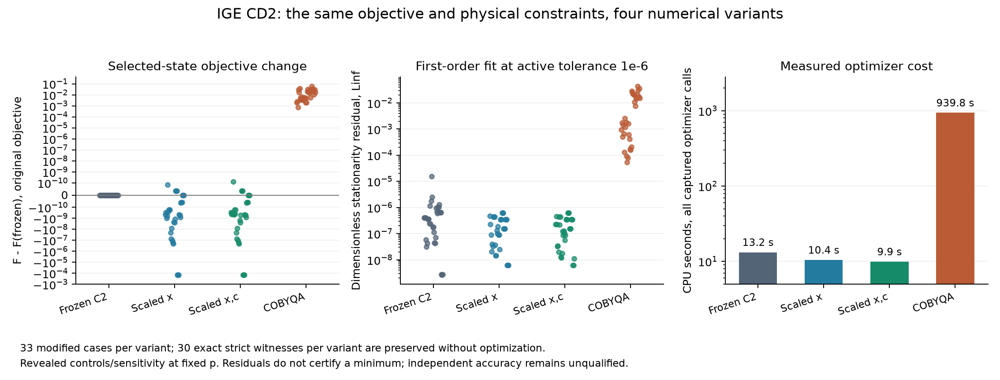

# CD2 — та же физическая задача, масштабированные координаты и независимый алгоритм

Дата: 23.10.2026. Ветка `research/ige-p9-3b3-cd2-scaled-independent-20261023`.
Регистрация опубликована **до CD2 решений**, коммит `c0f7942af8793cd3383a6e1e3c8018ffd26ee944`:
[протокол](IGE_P9_3B3_CD2_PREREG_RU_20261023.md), [JSON](../research/ige_cmip6/p9_3b3_cd2_protocol.json).
Родитель — завершённый CD1 `b6772d02f44604967779ebc1d8f4500e774dc280`.

**Локальный итог:** 63 случая, 252 результата, 396 сравниваемых trials; все 396 конечных trial states валидны по прежним допускам. Масштабированные SLSQP дали 99/99 solver success каждый и меньший либо численно эквивалентный исходный F во всех 33 случаях проекции. COBYQA при фиксированном бюджете дал более высокий F во всех 33 случаях. Это численный результат исследовательской выборки, не независимая accuracy qualification. Все 400 локальных тестов PASS; новый CI ещё предстоит проверить.

## Проверенное основание и границы эксперимента

CI CD1 [#39961593449](https://github.com/dmitrievii/building-energy-tools/actions/runs/39961593449) завершился SUCCESS, оба задания. Логи: 308 B3 + 14 P9.3A + 50 P9.2 + 8 P9.3B2 = 380 тестов; 63 случая, 99 trials, 99 физических validations, 8 выбранных failures и 5 случаев без успешного старта. Полный артефакт сохранён отдельно: [оригинальный ZIP](../research/ige_cmip6/p9_3b3_cd1_CI_39961593449.zip), SHA-256 `81cbfee41a6fe269bbe819b2ada0cc6afe9bb76471d7b2427eefc841df9255d2`.

Это подтверждает техническую полноту CD1, не точность относительно станций. Ошибка прежнего TPA1 аудита об отсутствии selected index исправлена дополнением CD1; старый отчёт не переписывался. Индекс и success выбранного старта уже присутствовали в frozen C2.

CD2 использует те же 63 TPA1 inputs и прежние три физических старта: 18 CONTROL_RH60, 18 CONTROL_Q90CAP_RH20, 27 NASA_2013_2014_REVEALED_SENSITIVITY. Из них 30 имеют exact strict witness и не оптимизируются; 33 требуют soft projection. При четырёх вариантах ожидаются 252 method results и 396 optimizer trials. Неуспехи входят в эти количества.

396 — число журналируемых сравнительных trials. Дополнительно выполняются 99 unobserved control optimizer calls для проверки наблюдателя: всего 495 фактических вызовов оптимизатора. Полное wall/CPU включает эти дополнительные вызовы и диагностику; таблица стоимости вариантов учитывает только сопоставляемые observed calls.

Изменений NASA-операторов, физики, source targets, pressure trajectories, donor priors и metric нет. CanESM5 v2 tas midrange и WATER_ICE source RH сохранены; WATER остаётся physical saturation cap. Конфликт метаданных tas и неподтверждённые native averaging bounds не закрыты этим экспериментом. Дискретные representative nodes не выдаются за доказанное воспроизведение суточного усреднения NASA.

Давление абсолютное, на историческом уровне T/RH; reduced DWD pressure не подставляется вместо него. p фиксировано во время closure, новая гидростатическая интеграция колонки после изменений T/q не выполняется. Перенос давления 2021 года на 2013/2014 остаётся раскрытой sensitivity, не генерацией давления целевого дня. Scope AT/DE/CH; новой независимой station weather truth не открывалось.

## Математическая эквивалентность

Исходный frozen C2 решает

$$
\min_{x\in[l,u]}F(x)=\frac12r(x)^TM^{-1}r(x)+\lambda S(x),\qquad
g(x)\ge0,\quad h(x)=0,\quad\lambda=0.01,
$$

$$
r(x)=\begin{pmatrix}
1000(\sum_i u_iq_i-\bar q_{\rm src})\\
\sum_i v_iRH_{\rm src}(T_i,p_i,q_i)-\overline{RH}_{\rm src}
\end{pmatrix},\qquad M=\operatorname{diag}(1^2,5^2).
$$

Единицы r: г/кг и процентные пункты. M — прежняя проектная sensitivity metric, не калиброванная error covariance NASA. Сохраняются исходные cap, T box, slopes, temperature operators, extrema и при наличии mean-T equality. q/RH в этом BOTH_SOFT эксперименте остаются мягкими; новые физические ограничения или penalties не вводятся.

Для x=(free T[K], q[g/kg]) положительная диагональная замена:

$$
x=c+Dy,\quad c=(T_{0,\rm free},0),\quad
D_T=2\,K,\quad D_q=1000\max(0.001,\mathrm{RMS}(q_0)).
$$

$$
\widetilde F(y)=F(c+Dy),\quad\nabla_y\widetilde F=D\nabla_xF,\quad
J_y\widetilde g=J_xgD,\quad
\widetilde l=(l-c)/D,\quad\widetilde u=(u-c)/D.
$$

В SCALED_XC дополнительно g/s_g и h/s_h с положительными константами: cap/Dq, slope/прежняя slope scale, mean T/2 K, mean q/Dq, mean RH/0.05 fraction. Точное допустимое множество не меняется. Меняются координаты и численные масштабы stopping tests; поэтому исходный физический валидатор применяется после обратного преобразования. Результат не клиппируется.

Целевая функция **при оптимизации не нормируется**, новый penalty в F отсутствует. Диагностическая нормировка CD1 F/max(1,|F_endpoint|) применяется только после solve. Её множитель зависит от endpoint; значения stationarity residual следует читать совместно с F, не как одинаковый абсолютный градиентный допуск разных endpoints.

| Вариант | Что изменилось относительно предыдущей строки |
|---|---|
| FROZEN_C2 | Исходная реализация, контроль |
| SLSQP_SCALED_X | Только центрирование и масштаб переменных |
| SLSQP_SCALED_XC | Дополнительно положительные масштабы ограничений |
| COBYQA_SCALED_XC | Другой алгоритм при тех же координатах, ограничениях и F |

Структурное обоснование масштабирования: для data term

$$
\nabla^2F_{\rm data}=J_r^TM^{-1}J_r+
\sum_{a=1}^{2}(M^{-1}r)_a\nabla^2r_a.
$$

Gauss–Newton часть имеет ранг не выше двух, поскольку ежедневных мягких диагностик две. **Полный Hessian не обязан иметь ранг два:** второй член и prior дают дополнительную кривизну. В координатах y выбранные D прямо соответствуют прежним шкалам квадратичного prior T/q; это preconditioning исходной задачи. Такое устройство объясняет интерес к масштабированию без подгонки весов. Оно не доказывает причинность каждой наблюдаемой остановки и не заменяет измерение Hessian conditioning.

## Независимый численный путь и фазы

COBYQA строит quadratic interpolation models и не получает analytic derivatives. Он использует ту же исходную функцию, те же bounds и nonlinear constraints: [SciPy COBYQA](https://docs.scipy.org/doc/scipy/reference/optimize.minimize-cobyqa.html), [первоисточник](https://arxiv.org/abs/2210.12018). Исполняется pinned SciPy 1.17.0, wrapper проверен по установленному исходному коду. Канонический Python evaluator F внутри вычисляет gradient вместе со значением, но COBYQA получает только scalar value; стоимость относится к данной реализации адаптера.

Во всех оценках используется точный WATER_ICE switch на 273.15 K, вода при T≥273.15 K. Сглаживание и дополнительные phase bounds отсутствуют. Скачок двух saturation formulas не исчезает от отсутствия производных у алгоритма. Никаких гарантий smooth optimization через этот скачок не заявляется. CD1 KKT fit и FD остаются branch-local diagnostics.

## Реализация и независимые проверки

[Solvers](../research/ige_cmip6/p9_3b3_cd2_solvers.py) использует тот же frozen `project_day` function bytecode с isolated globals, заменяя только вызываемый minimize. Исходный модуль не меняется. Frozen strict-first, preservation exact witness и выбор минимального **исходного F** среди независимо валидированных конечных кандидатов сохранены. Solver success не становится фильтром выбора. Каждый FROZEN_C2 выполняется с unobserved контролем, сравниваются все raw fields и массивы точно в одной среде.

Все варианты получают одни и те же исходные физические start arrays; это проверяется их SHA. Арифметика прямого/обратного coordinate map выполняется в float64, математическая эквивалентность не трактуется как побитовое равенство всех новых траекторий. Общие coordinate scales в result metadata используются также для CD1 diagnostics; для FROZEN_C2 map к оптимизатору не применяется, что указано `scaled_variables=False`.

Для каждого trial сохраняются initial/final x, solver flags/status/message, nit/nfev/njev, CPU/wall, rejection/algorithm error, исходный F, validation, trace, CD1 first-order fits при трёх active tolerances и FD при двух шагах. При исключении алгоритма не подставляется initial/last state: trial явно rejected, а случай при отсутствии валидных кандидатов остаётся UNRESOLVED. Это не физическое доказательство infeasibility.

Поле `iteration_journal` нумерует callbacks. Для SLSQP это основные итерации; для COBYQA — последовательность оценок функции, включая interpolation/geometry probes. Поэтому одинаковый ordinal не означает одинаковый шаг алгоритма. Phase-crossing counts и размах последних десяти F в этих последовательностях имеют разные значения и не сравниваются как одна и та же мера сходимости.

[Независимый аудит](../research/ige_cmip6/audit_p9_3b3_CD2.py) заново проверяет выбранные states скалярным physical validator и считает исходный F отдельными scalar gas-law, mean и roughness expressions через math.fsum. Он не использует production objective/gradient для этого пересчёта. Проектные веса и λ сохраняются. Нормированная ошибка сравнивается с заранее зарегистрированной numerical F tie scale, не с подобранным по outcomes допуском accuracy.

Новые 20 тестов: invertibility/bounds, positive scales, objective/Jacobian chain rule, отсутствие clipping, freezing threshold и соседние float64, analytic constrained quadratic, отдельный 1D thermodynamic optimum, отсутствие analytic derivatives на входе COBYQA, одинаковые starts и pressure, strict preservation, explicit failure retention, scalar zero/unit-residual/roughness oracles и immutable protocol. Всего PASS **328 B3 + 14 P9.3A + 50 P9.2 + 8 P9.3B2 = 400**; canonical absolute DWD pressure contract также PASS. 139 прежних контрольных SHA неизменны.

## Полные локальные результаты

| Вариант | Valid trials | Solver success trials | Success выбранного /33 | F ниже / tie / выше /33 | CPU optimizer calls | nfev |
|---|---:|---:|---:|---:|---:|---:|
| Frozen C2 | 99/99 | 80/99 | 25/33 | 0 / 33 / 0 | 13.21 s | 14105 |
| SLSQP scaled x | 99/99 | 99/99 | 33/33 | 17 / 16 / 0 | 10.43 s | 9735 |
| SLSQP scaled x,c | 99/99 | 99/99 | 33/33 | 16 / 17 / 0 | 9.91 s | 9702 |
| COBYQA scaled x,c | 99/99 | 3/99 | 1/33 | 0 / 0 / 33 | 939.76 s | 36148 |

Algorithm exceptions: 0. 30/30 exact strict witnesses сохранены на каждом варианте; все 63 control observed/unobserved outputs совпадают точно. Независимая scalar-перепроверка всех 252 выбранных/preserved states даёт max относительное расхождение F **1.069e−15**. 1188 bounded first-order LS fits выполнены без fit failure.

Таблица F comparisons относится только к **33 modified cases**. 30 strict witnesses на вариант не оптимизировались; включение их нулевых различий в таблицу скрыло бы различия численных методов. Numerical tie означает |ΔF|≤1e−10 max(1,|F_control|), как указано до эксперимента. Это не scientific correction budget.

| Вариант | Stationarity L∞ min / median / max | Max ΔT к control | Max Δq к control |
|---|---:|---:|---:|
| Frozen C2 | 2.638e-09 / 3.555e-07 / 1.565e-05 | 0.000000 K | 0.000000 г/кг |
| SLSQP scaled x | 6.251e-09 / 1.568e-07 / 6.234e-07 | 1.223763 K | 1.099270 г/кг |
| SLSQP scaled x,c | 6.251e-09 / 1.568e-07 / 6.234e-07 | 1.223763 K | 1.099270 г/кг |
| COBYQA scaled x,c | 5.438e-05 / 1.850e-03 / 4.336e-02 | 3.565641 K | 16.395936 г/кг |

First-order residual получен bounded LS fit с bound multipliers при τ=1e−6, одинаковым рецептом CD1. Полные результаты τ=1e−8/1e−6/1e−4 сохранены. Ни малый residual, ни solver success, ни нижний F среди четырёх найденных кандидатов не являются local/global minimum certificate. Проверки constraint qualification и second-order sufficiency не заменены LS fit.

| Вариант | Max FD error ∇F, h=5e−6 | Max FD error Jacobian | UNAVAILABLE columns на каждом из двух h |
|---|---:|---:|---:|
| Frozen C2 | 1.668e-06 | 1.048e-07 | 0 |
| SLSQP scaled x | 1.669e-06 | 1.051e-07 | 951 |
| SLSQP scaled x,c | 1.669e-06 | 1.059e-07 | 771 |
| COBYQA scaled x,c | 1.669e-06 | 1.052e-07 | 996 |

Доступные колонки согласуются с analytic derivatives на указанных шагах, однако **FD coverage новых вариантов неполное**. В 21/17/22 trials соответственно имеется выход за точный q box максимум на 1.7763568394002505e−15 г/кг после float64 обратного преобразования. Выходов за T box нет. Состояния проходят прежний физический валидатор с его численными допусками. Неизменённый CD1 FD checker требует, чтобы все координаты stencil point были внутри exact box; малый overshoot непертурбируемой координаты блокирует многие колонки. Все trials с UNAVAILABLE имеют такой overshoot; исходные UNAVAILABLE записи сохранены, состояния не клиппировались. Это ограничение полноты диагностики, не доказательство ошибки градиента и не повод считать все производные проверенными. [Дополнительные численные факты](../research/ige_cmip6/p9_3b3_cd2_supplementary_numeric_scope_20261023.json) отделены от preregistered результатов.

В этом повторе масштабирование устранило исходные iteration-limit failures SLSQP и уменьшило верхнюю границу наблюдаемого stationarity residual с 1.565e−5 до 6.234e−7. Число success не является самостоятельным математическим доказательством минимума. Между scaled x и scaled x,c максимальная разница F составляет 7.038e−10, T — 0.002085 K, q — 0.001269 г/кг. Оснований объявлять один из этих двух вариантов научно точнее нет.

Наибольшее изменение профиля относительно frozen C2 относится к раскрытому AT / 2013-01-19: до **1.223763 K** и **1.099270 г/кг** при уменьшении F примерно на 1.392e−4. Это важнее одного флага success: улучшение функционала не гарантирует сохранения часового профиля. Возможны слабая определённость профиля суточными диагностическими данными и разные локальные траектории; глобальная причина/единственность решения не доказаны. Пример остаётся regression, параметры по нему не подгонялись.

COBYQA имеет 96/99 iteration-limit statuses и 3/99 successes; у выбранных кандидатов success только 1/33. Его F выше frozen C2 на 0.000759…0.059310, медиана 0.010727. Минимальный stationarity residual COBYQA 5.438e−5 уже выше максимального residual scaled SLSQP в этом наборе. Это свидетельство недостаточного результата **данного bounded запуска**, не доказательство неспособности COBYQA при другом бюджете или на другой задаче. Бюджет не увеличивался после результатов. Solver-success COBYQA также не гарантирует меньшего F: выбранный единственный успешный результат входит в 33 более высоких F.

До изменения исследовательского default нужны CI reproduction, межсредовая устойчивость и отдельная корректно зарегистрированная проверка FD stencil coverage с учётом float64 границ без изменения состояний/физики. Стабильность hourly profiles следует оценивать отдельно от близости F.



## Бюджет и воспроизведение

Все maxiter=180. SLSQP ftol=1e−11. COBYQA maxfev=2000, initial_tr_radius=1, final_tr_radius=1e−6, feasibility_tol=1e−9, scale=False. Не менялись после просмотра результатов. Одинаковое число итераций не даёт одинаковой работы или одинаковой точности stopping tests; это ограниченный зарегистрированный эксперимент, не универсальный рейтинг алгоритмов.

Измерено 1079.86 s wall / 1079.74 s CPU (около 18.00 min), peak RSS 119672 KiB (116.87 MiB). Python 3.12.14, NumPy 2.3.5, SciPy 1.17.0; один BLAS/OMP поток. Установка зависимостей, тесты и упаковка итогового архива в измерение replay не входят. Зарегистрированная оценка 2–15 CPU min оказалась ниже фактических примерно 18 min; она не переписывалась. Главная стоимость — COBYQA: 15.66 min только captured solver calls. Это измерение данной реализации, не универсальный performance benchmark.

Пример запуска из корня репозитория с pinned dependencies и одним BLAS/OMP потоком:

```bash
OPENBLAS_NUM_THREADS=1 OMP_NUM_THREADS=1 python -m unittest discover -s research/ige_cmip6 -p 'test_p9_3b3_*.py' -q
OPENBLAS_NUM_THREADS=1 OMP_NUM_THREADS=1 python -u research/ige_cmip6/p9_3b3_cd2_run.py --out outputs/CD2-new-replay
python research/ige_cmip6/audit_p9_3b3_CD2.py --input outputs/CD2-new-replay --out outputs/CD2-new-replay/scalar_audit.json
```

Нужна новая output directory; старые результаты не перезаписываются. [Workflow](../.github/workflows/ige-p9-3b3-cd2-equivalent-solvers.yml) выполняет все suites, checksums, полный replay и отдельный scalar audit. CI реализации запускается после публикации; локальные PASS не объявляются его итогом.

[Машиночитаемый аудит и выбранные метрики](../research/ige_cmip6/p9_3b3_cd2_verified_local_summary_20261023.json).
[Полные журналы всех случаев и всех вариантов, JSON.XZ](../research/ige_cmip6/p9_3b3_cd2_verified_local_replay_20261023.json.xz).
Архив: 4610392 bytes, SHA-256 `f25005e89f387f5069430cea419f1c2f455919718203ac943655b5047c728bc0`. Он содержит точный CD2_summary и все 63 полных case journals с четырьмя вариантами. Ошибка обработки относительного пути при первоначальном экспорте исправлена отдельно и покрыта регрессионным тестом; уже записанный архив проверен полным decompress/equality, optimizer outputs не менялись.

Git head локального replay относится к prereg commit, поскольку реализация тогда ещё не была опубликована. SHA обоих исполнявшихся CD2 modules сохранены в summary и совпадают с публикуемым кодом. Внешний scalar audit и plotting code не меняют solver results. [Код фигуры](../research/ige_cmip6/plot_p9_3b3_CD2.py).

## Что разрешено интегрировать

CD2 добавляет исследовательские варианты и сравнение. Frozen C2, старые результаты и defaults не заменены. До выбора исследовательского кандидата нужно проверить CI и межсредовую устойчивость F, профилей, flags и first-order metrics. Численное улучшение исходного F само по себе не доказывает уменьшения ошибки по наблюдениям.

Отдельная будущая квалификация требует ещё не раскрытой preregistered AT/DE/CH выборки, исторических высот и pressure semantics. 2013/2014 и 2021 сохраняют роль раскрытых regressions/sensitivity. Глобальные исследования отложены до научной публикации. Нужны также дальнейшее закрытие NASA time support и обоснование correction budget; fixed-p closure не выдаётся за полностью переинтегрированную T–p–q колонку.

| Уровень | Состояние |
|---|---|
| Корректность кода | 400 local tests PASS; frozen controls и same-problem checks; новый CI ожидается |
| Физическая допустимость | Проверяется на исходной fixed-p задаче; полные valid/rejected trial counts опубликованы |
| Независимая точность | NOT_QUALIFIED |
| Эксплуатационная готовность | NOT_QUALIFIED; correction budget NOT_ESTABLISHED |

Local/global optimum не сертифицирован. B4 не квалифицирован; native future GCM pressure не восстановлено; production EPW не готов. Main и прежние ветки не изменялись, merge не выполнялся.
